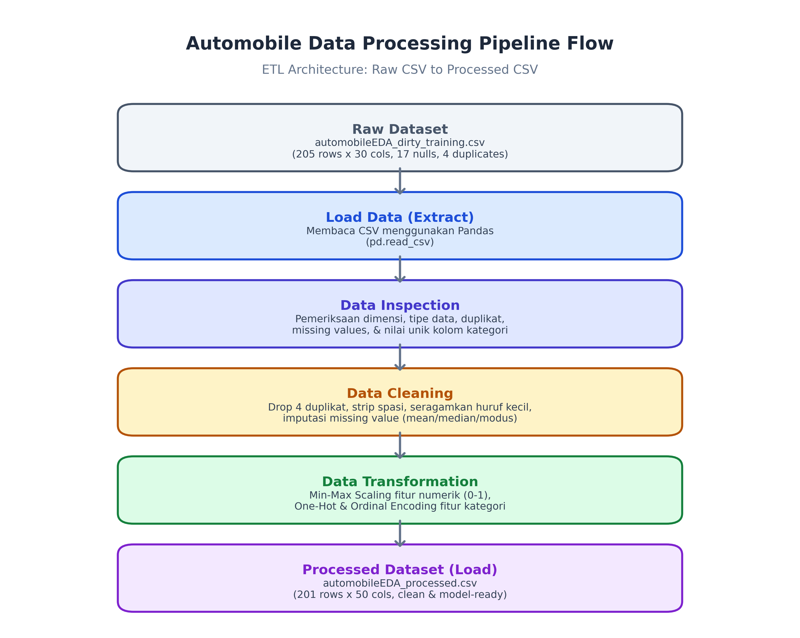

# Data Preparation & Pipeline Project - Automobile Dataset
Program AI Engineering Bootcamp

---

## 1. Deskripsi Project & Dataset
Project ini bertujuan untuk membangun alur pengolahan data structured/tabular otomatis menggunakan konsep ETL (Extract, Transform, Load) dengan Python dan Pandas. Dataset mentah yang digunakan memiliki sejumlah permasalahan kualitas data seperti missing values, duplikasi data, ketidakkonsistenan penulisan teks, format tanggal yang beragam, serta fitur-fitur yang memerlukan penskalaan dan encoding agar siap digunakan untuk analisis atau pemodelan Machine Learning.

- **Sumber Dataset**: Dataset otomotif `automobileEDA_dirty_training.csv` (berisi data spesifikasi teknis dan karakteristik mobil seperti dimensi, mesin, bahan bakar, performa, dan harga).
- **Lokasi Processed Dataset**: `data/processed/automobileEDA_processed.csv`.

---

## 2. Struktur Folder Project
Struktur folder project disusun mengikuti standar berikut:
```
data-pipeline-assignment/
├── data/
│   ├── raw/
│   │   └── automobileEDA_dirty_training.csv
│   └── processed/
│       └── automobileEDA_processed.csv
├── src/
│   └── pipeline.py
├── documentation/
│   └── data-flow-diagram.png
├── README.md
└── requirements.txt
```

---

## 3. Cara Menginstal Dependency & Menjalankan Script
Untuk menjalankan project ini, pastikan Python sudah terinstal di komputer.

1. Buka terminal atau VS Code pada folder root project.
2. Instal seluruh dependency yang tercantum di file `requirements.txt`:
   ```bash
   pip install -r requirements.txt
   ```
3. Jalankan pipeline script:
   ```bash
   python src/pipeline.py
   ```
Script akan mengeksekusi seluruh tahapan ETL secara otomatis, menampilkan proses pemeriksaan dan log pembersihan data di terminal, serta menyimpan output bersih ke folder `data/processed/`.

---

## 4. Penjelasan Alur ETL
Alur pipeline dirancang berdasarkan prinsip ETL:
- **Extract**: Membaca dataset CSV mentah dari `data/raw/automobileEDA_dirty_training.csv` menggunakan fungsi `load_data()`.
- **Transform**:
  - `inspect_data()`: Memeriksa struktur, tipe data, missing values, duplikat, dan nilai unik kolom kategorikal (Task B).
  - `clean_data()`: Membersihkan data mentah dari duplikat, spasi tidak beraturan, format yang tidak konsisten, serta menangani missing values dan perbaikan tipe data (Task C).
  - `transform_data()`: Melakukan penskalaan data numerik (Min-Max Scaling) dan encoding data kategorikal (One-Hot, Ordinal, dan Frequency Encoding) (Task D).
- **Load**: Menyimpan dataset yang telah siap dimodelkan ke `data/processed/automobileEDA_processed.csv` menggunakan fungsi `save_data()` (Task F).

---

## 5. Dokumentasi Pengerjaan & Temuan

### Task B [
1. Sebelum melakukan pembacaan data pada CSV, dibutuhkan library pandas yang dapat diinstall langsung seperti "pip install pandas" atau melalui requirements.txt. Dalam percobaan saya ketika install pandas lalu cek di pip list juga sudah terinstall numpy.

2. Setelah pandas terinstall, maka lakukan import pada file pipeline.py dengan tambahan inisial pd, menjadi "import pandas as pd".

3. Lalu untuk membaca csv cukup simpan dalam function df dengan value pd.read_csv("path csv data").

Lalu gunakan df.head untuk melihat 5 data teratas di data csv.

4. Gunakan df.shape untuk melihat total baris dan kolom data CSV.

5. Untuk melihat semua header kolom, gunakan df.columns.tolist(), tidak menggunakan tolist() juga bisa tapi dia type nya index.

6. Untuk melihat tipe data tiap kolom, gunakan "df.dtypes". Dengan mengetahui tipe data tiap kolom, kedepannya dapat melakukan pengelompokan kolom dari tipe datanya.

7. Setelah itu, perlu juga untuk melihat apakah ada missing value di masing-masing kolom, jika ada totalnya berapa, itu dapat dilihat dengan syntax "df.isnull().sum()" namun outputnya akan berupa total masing-masing kolom, kalau mau semua dijadikan satu maka beri tambahan function sum() kembali setelah function sum() jadi seperti ini "df.isnull().sum().sum()".

8. Setelah mendapat missing value, perlu juga melihat apakah ada data yang duplikat, kalau hanya ingin melihat data mana yang duplikat maka pakai "df.duplicated()" kalau ingin ditotal aja berapa data duplicat maka pakai "df.duplicated().sum()".
   Karena dalam proses saya, saya butuh sum untuk tau aja berapa yang duplicat nanti bisa di drop dan di cek perbedaan data sebelum drop duplicat totalnya berapa dan sesudahnya berapa.

9. Ketika mau melihat nilai unik dari masing-masing kolom, step 6 diperlukan disini. Ketika kamu sudah tau tipe data kolom maka dapat melakukan filter dengan membuat function baru lalu menggunakan
   df.select_dtypes(
   include="str"
   ).columns
   untuk mengambil kolom dengan tipe data string.
   Pada keterangan vscode ketika di hover ke select_dtypes, disitu sudah jelas bahwa method ini digunakan untuk "Return a subset of the DataFrame's columns based on the column dtypes."

Lalu lakukan perulangan untuk melihat data unique masing-masing kolom. Untuk melihatnya dapat menggunakan
for data in function:
print(df[data].unique().tolist()).
Penggunakan tolist sudah saya jelaskan diatas, untuk function unique() untuk mengambil perwakilan dari data dengan nama atau value yang sama.

Resume:
Dengan step-step tersebut, dapat diketahui bahwa data automobileEDA memiliki:

- 205 rows x 30 columns.
- Terdapat total 17 missing values.
- Total terdapat 4 data duplikat
- Terdapat kolom dengan tipe data yang tidak sesuai yaitu kolom num-of-doors yang lebih baik diubah menjadi tipe data integer atau int64 karena valuenya setelah dilihat hanya two dan four, sebuah sebutan untuk angka integer, tidak menggunakan float karena tidak memerlukan angka koma.
- Terdapat penulisan kategori yang belum konsisten seperti di kolom make dia ada alfa-romero dan ALFA-ROMERO.
  Lalu di kolom body-style terdapat sedan, Sedan dan SEDAN.
  transaction_date juga format tanggalnya tidak konsisten.
- Terdapat juga data nan yang tidak sesuai dengan tipe data kolomnya.
]

---

### TASK C [
Pada tahap ini dilakukan pembersihan data (Data Cleaning) berdasarkan permasalahan yang sudah ditemukan pada Task B di atas. Berikut langkah-langkah penanganannya dan alasan pemilihan metode:

1. **Menghapus Data Duplikat (Duplicate Records)**:
   - *Cara*: Menggunakan `df.drop_duplicates().reset_index(drop=True)`.
   - *Alasan*: Pada pengecekan di Task B ditemukan 4 baris data yang duplikat persis (indeks 201 s.d 204 merupakan duplikat dari data sebelumnya). Baris duplikat ini harus dibuang karena data yang redundan dapat membuat bobot data menjadi bias atau menyebabkan model mengalami overfitting terhadap data kembar tersebut.
   - *Hasil*: Data berkurang dari 205 baris menjadi 201 baris (4 duplikat dihapus).

2. **Menyeragamkan Penulisan Teks & Menghapus Spasi**:
   - *Cara*: Menggunakan `.str.strip()` untuk memotong spasi liar dan `.str.lower()` untuk mengubah semua teks menjadi huruf kecil pada kolom-kolom kategorikal (`make`, `body-style`, `drive-wheels`, `engine-location`, `engine-type`, `fuel-system`, `aspiration`).
   - *Alasan*: Pada kolom `make` ada spasi di ujung kata seperti `'dodge  '` dan `'mercury  '`, serta huruf besar seperti `'ALFA-ROMERO'`. Pada kolom `body-style` ada `'SEDAN'`, `'Sedan'`, dan `'sedan'`. Pada kolom `fuel-system` ada `'MPFI'` dan `'Mpfi'`. Jika tidak diseragamkan ke lowercase dan di-strip spasinya, komputer/pandas akan membaca kategori yang sama sebagai kategori yang berbeda.
   - Selain itu, pada kolom `drive-wheels`, nilai `'awd'` diseragamkan menjadi `'4wd'` karena keduanya sama-sama sistem penggerak 4 roda pada kategori dataset mobil ini.

3. **Menyeragamkan Format Tanggal (`transaction_date`)**:
   - *Cara*: Menggunakan `pd.to_datetime(df['transaction_date'], dayfirst=True, format='mixed')` lalu diformat seragam menjadi bentuk string `YYYY-MM-DD` (`.dt.strftime('%Y-%m-%d')`).
   - *Alasan*: Di data mentah terdapat banyak format tanggal yang tercampur seperti `YYYY-MM-DD`, `DD/MM/YYYY`, `MM-DD-YYYY`, dan `DD-Mon-YYYY`. Selain itu terdapat nilai kosong pada kolom ini yang diimputasi menggunakan `ffill()` (forward fill) lalu `bfill()`.

4. **Menangani Missing Values pada Kolom Kategorikal**:
   - Kolom `make`: Terdapat 1 missing value (setelah duplikat dihapus). Kolom ini diisi dengan modus (`df['make'].mode()[0]`) atau nilai yang paling sering muncul agar tidak kehilangan baris data mobil yang spesifikasi lainnya masih lengkap.
   - Kolom `num-of-doors`: Terdapat 2 baris bernilai kosong (NaN) pada mobil bertipe sedan (BMW dan Mercedes). Berdasarkan karakteristik dataset, sebagian besar sedan memiliki 4 pintu (modus sedan adalah `'four'`), sehingga nilai kosong diimputasikan dengan `'four'`.
   - Kolom `horsepower-binned`: Terdapat 1 missing value pada baris mobil Jaguar bertenaga 262 hp. Diisi dengan modus atau kategori yang sesuai tingkat tenaganya (`'High'`).

5. **Memperbaiki Tipe Data Kolom `num-of-doors`**:
   - *Cara*: Melakukan mapping sebutan teks string `'two'` menjadi angka 2 dan `'four'` menjadi angka 4, lalu diubah tipe datanya menjadi integer (`int`).
   - *Alasan*: Seperti yang sudah saya jelaskan di resume Task B, jumlah pintu merupakan nilai diskrit/bilangan bulat. Menyimpannya sebagai angka bulat lebih tepat untuk pengolahan matematis daripada teks string.

6. **Menangani Missing Values pada Kolom Numerik**:
   - Kolom `stroke`: Terdapat 4 nilai kosong pada mobil Mazda dengan tipe mesin `rotor` (rotary). Mesin rotary secara teknis tidak memakai piston silinder biasa sehingga stroke-nya kosong. Nilai kosong ini diisi menggunakan rata-rata (`mean()`) kolom `stroke` agar nilai numerik tetap terwakili secara objektif tanpa mengubah distribusi rata-rata dataset.
   - Kolom `horsepower`: Terdapat nilai kosong yang diimputasi dengan nilai tengah (`median()`), karena median lebih aman dari pengaruh nilai horsepower ekstrem/outlier.
   - Kolom `price`: Terdapat 3 nilai kosong. Kolom harga diimputasikan dengan nilai tengah (`median()`) dari harga mobil, karena harga mobil memiliki variasi yang cukup tinggi (ada beberapa mobil mewah dengan harga sangat tinggi yang bisa mendistorsi nilai mean).

Resume Data Cleaning:
- **Jumlah data sebelum cleaning**: 205 baris x 30 kolom
- **Jumlah data sesudah cleaning**: 201 baris x 30 kolom
- **Jumlah data duplikat yang dihapus**: 4 baris
- **Jumlah missing values sebelum cleaning**: 17 missing values
- **Jumlah missing values sesudah cleaning**: 0 missing values
- **Kolom yang mengalami perubahan / pembersihan**: `make`, `body-style`, `drive-wheels`, `fuel-system`, `transaction_date`, `num-of-doors`, `stroke`, `horsepower`, `price`, `horsepower-binned`.
]

---

### TASK D [
Pada tahap ini dilakukan proses transformasi data (Data Transformation) agar data siap digunakan untuk analisis atau algoritma Machine Learning. Transformasi yang dilakukan meliputi normalisasi numerik dan encoding data kategorikal.

1. **Normalisasi Kolom Numerik menggunakan Min-Max Scaling**:
   - *Metode*: Min-Max Scaling dengan rumus:
     $$\text{Nilai Baru} = \frac{X - X_{min}}{X_{max} - X_{min}}$$
     menggunakan `MinMaxScaler()` dari library `sklearn.preprocessing`.
   - *Kolom yang dinormalisasi*: Kolom numerik utama seperti `price`, `horsepower`, `curb-weight`, `engine-size`, `peak-rpm`, `city-mpg`, `highway-mpg`, dan `symboling`.
   - *Alasan pemilihan kolom*: Fitur-fitur seperti `price` (rentang sekitar 5.118 s.d 45.400) dan `horsepower` (rentang 48 s.d 262) memiliki skala nilai yang sangat besar dibandingkan fitur lain. Tanpa penskalaan, algoritma Machine Learning berbasis jarak (seperti KNN, Regresi Linier, atau Neural Network) akan lebih berat sebelah/bias ke fitur dengan angka besar. Min-Max Scaling mengubah skala semua nilai tersebut ke rentang yang sama yaitu antara 0 dan 1.

2. **Encoding Kolom Kategorikal**:
   - **One-Hot Encoding**: Diterapkan pada kolom kategorikal nominal tanpa tingkatan, yaitu `body-style`, `drive-wheels`, `aspiration`, `engine-type`, `engine-location`, dan `fuel-system` menggunakan fungsi `pd.get_dummies()`.
     - *Alasan*: Variabel nominal tidak memiliki tingkatan atau urutan logis (misalnya sedan tidak lebih tinggi dari hatchback). Dengan One-Hot Encoding, setiap kategori diubah menjadi kolom biner terpisah (berisi angka 0 atau 1) agar model AI tidak menganggapnya sebagai peringkat/angka urut.
   - **Ordinal Encoding**: Diterapkan pada kolom `horsepower-binned` (menjadi kolom baru `horsepower_ordinal`) dengan pemetaan `{'Low': 0, 'Medium': 1, 'High': 2}`.
     - *Alasan*: Kategori ini memiliki tingkatan/urutan alami yang jelas (daya mesin rendah < sedang < tinggi).
   - **Frequency Encoding**: Diterapkan pada kolom `make` (menjadi kolom baru `make_freq`) dengan menghitung proporsi kemunculan tiap merek di dataset (`value_counts(normalize=True)`).
     - *Alasan*: Merek mobil memiliki banyak nilai unik (kardinalitas tinggi). Jika di-One-Hot Encoding akan menghasilkan terlalu banyak kolom baru yang boros memori (curse of dimensionality). Dengan frequency encoding, informasi frekuensi/popularitas merek tetap tersampaikan dalam satu kolom numerik.
   - **Penskalaan `num-of-doors` dan `num-of-cylinders`**: Kolom `num-of-doors` diubah menjadi biner rasio (two: 0.0, four: 1.0) dan `num-of-cylinders` dipetakan dari teks nama angka (two=2, four=4, six=6, dst.) lalu di-scale min-max.

3. **Tabel Contoh Perbandingan Nilai Sebelum dan Sesudah Transformasi**:

Berikut perbandingan nilai pada 5 baris pertama sebelum transformasi (data setelah dibersihkan) dan sesudah transformasi:

| No | Kolom | Nilai Sebelum Transformasi | Kolom Baru / Berubah | Nilai Sesudah Transformasi | Keterangan Metode |
|---|---|---|---|---|---|
| 1 | `price` | `13495.0` | `price` | `0.2080` | Min-Max Scaling (rentang 0 - 1) |
| 2 | `price` | `16500.0` | `price` | `0.2826` | Min-Max Scaling (rentang 0 - 1) |
| 3 | `horsepower` | `111.0` | `horsepower` | `0.2944` | Min-Max Scaling (rentang 0 - 1) |
| 4 | `horsepower` | `154.0` | `horsepower` | `0.4953` | Min-Max Scaling (rentang 0 - 1) |
| 5 | `body-style` | `'convertible'` | `body-style_convertible` | `1` (kolom lain `0`) | One-Hot Encoding |
| 6 | `body-style` | `'sedan'` | `body-style_sedan` | `1` (kolom lain `0`) | One-Hot Encoding |
| 7 | `horsepower-binned` | `'Medium'` | `horsepower_ordinal` | `1` | Ordinal Encoding (Low: 0, Med: 1, High: 2) |
| 8 | `horsepower-binned` | `'Low'` | `horsepower_ordinal` | `0` | Ordinal Encoding (Low: 0, Med: 1, High: 2) |
| 9 | `make` | `'alfa-romero'` | `make_freq` | `0.0149` | Frequency Encoding |
| 10 | `num-of-doors` | `'two'` / `2` | `num-of-doors` | `0.0` | Binary / Min-Max Scaled |
| 11 | `num-of-doors` | `'four'` / `4` | `num-of-doors` | `1.0` | Binary / Min-Max Scaled |
]

---

### TASK E & F [
Seluruh fungsi pemrosesan data telah digabungkan ke dalam file `src/pipeline.py` dan dapat dieksekusi secara otomatis dari awal hingga akhir dalam satu kali perintah `python src/pipeline.py`.

- **Hasil Akhir**: Dataset yang telah dibersihkan dan ditransformasikan tersimpan secara otomatis di file:
  `data/processed/automobileEDA_processed.csv`
- **Dimensi Akhir**: 201 baris x 49 kolom, tanpa ada missing value atau data duplikat, dan seluruh fitur siap digunakan untuk pemodelan machine learning.
- Dataset mentah di folder `data/raw/automobileEDA_dirty_training.csv` tetap aman dan tidak mengalami penimpaan/perubahan data.
]

---

### TASK G (Data Flow Diagram) [
Diagram alur pengolahan data telah dibuat dan disimpan di folder `documentation/data-flow-diagram.png`.

Diagram tersebut menggambarkan 5 tahapan utama pipeline data:
1. **Raw Dataset**: `automobileEDA_dirty_training.csv` (205 baris x 30 kolom).
2. **Load Data (Extract)**: Memuat dataset ke DataFrame Pandas.
3. **Data Inspection**: Memeriksa bentuk, kolom, tipe data, missing values, duplikat, dan nilai unik.
4. **Data Cleaning**: Menghapus duplikat, merapikan teks, standarisasi format tanggal, dan imputasi nilai kosong.
5. **Data Transformation**: Min-Max Scaling pada kolom numerik dan Encoding pada kolom kategorikal.
6. **Processed Dataset (Load)**: Menyimpan output bersih ke `data/processed/automobileEDA_processed.csv` (201 baris x 49 kolom).


]
